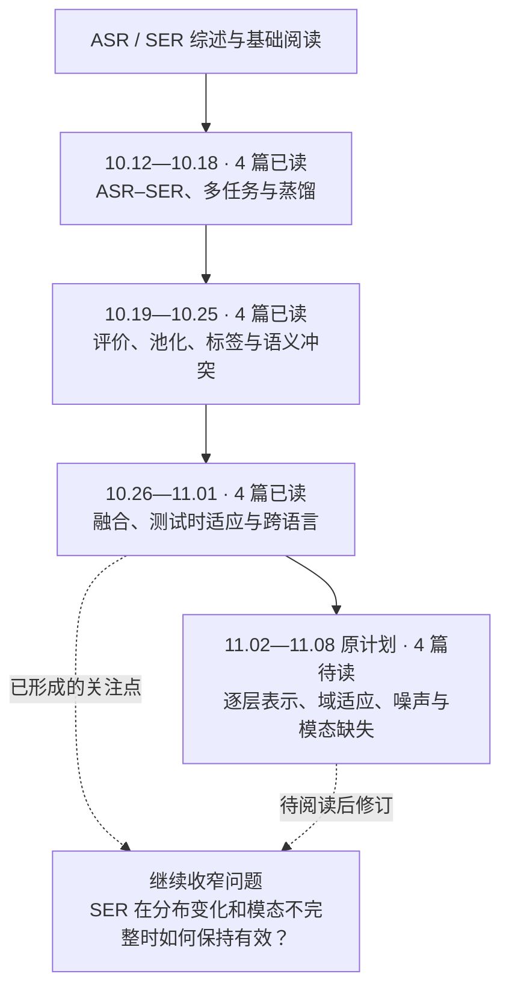
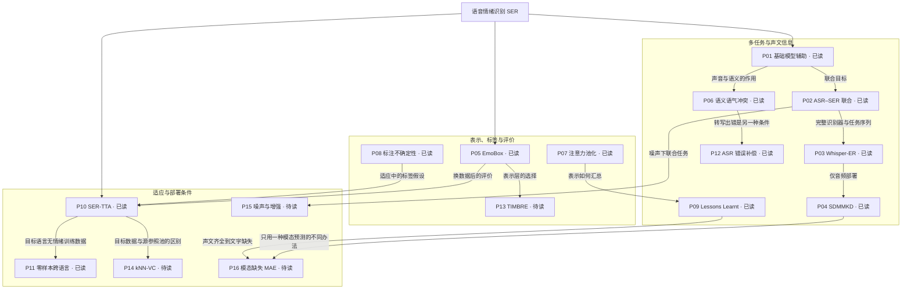

# 语音情绪识别研究地图

图中的箭头表示个人阅读衔接与问题联系，不表示已经核实的论文引用关系。节点直接标注已读或待读；完整题名见[文献清单](REFERENCES.md)，已有认识及回读问题见[阅读记录](READING.md)。

## 我的阅读历程

## 论文与问题的联系

读图时优先跟随现有四篇积压：P13 → P14 → P15 → P16。P13 对照 P05 / P07；P14 回看 P10；P15 回看 P02；P16 回看 P04 / P09 / P12。已有论文只安排定向回读。
