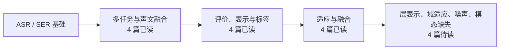

# 语音情绪识别文献地图：我的阅读与研究历程

记录从 ASR / SER 基础阅读，到多任务与声文融合，再到评价、测试时适应和模态缺失的研究过程。

截至 **2026-11-11**：**12 篇已有阅读笔记，4 篇上周顺延待读**，另保留 2 篇基础综述入口。

- [研究地图](MAP.md)：按研究历程和问题联系阅读。
- [完整文献清单](REFERENCES.md)：题名、出处、原文入口及阅读状态。
- [阅读记录与来源](READING.md)：每篇已有认识、下一步问题及原报告版本。

阅读状态来自已有完整周报和本人当前确认；题名、出处与笔记修订分别保留来源。论文阅读和方法复现分别记录，阅读顺序与问题联系不等同于学术引用关系。

更新时，在对应阅读条目补充实际日期、读到的位置、理解变化和原文位置，再同步文献清单与地图中的状态，保留一次 Git 提交。

原创整理与笔记采用 [MIT License](LICENSE)。链接所指论文、数据及第三方代码遵循各自许可。
